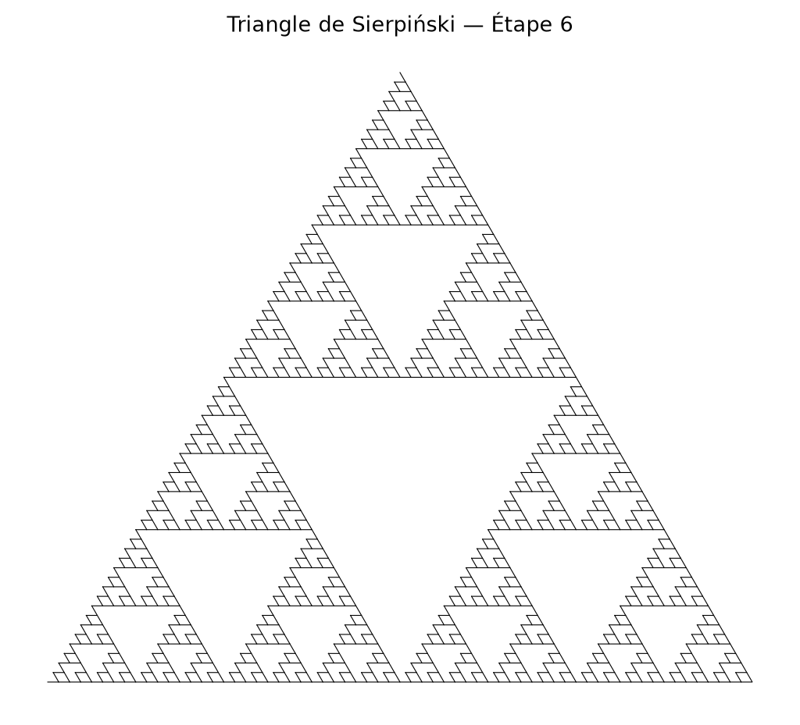

# Génération d'images fractales par IFS

Projet universitaire de mathématiques appliquées encadré par **Rodolphe Garbit**, Université d'Angers (2 ECTS).

## Présentation

Ce projet étudie la génération de figures fractales à l'aide de **systèmes de fonctions itérées** (*Iterated Function Systems*, IFS). Un IFS est un ensemble fini d'applications contractantes. L'itération de ces transformations permet d'approcher un attracteur, dont l'existence et l'unicité sont justifiées, sous les hypothèses appropriées, par le théorème du point fixe de Banach appliqué à l'espace des compacts muni de la distance de Hausdorff.

Le programme utilise des transformations affines du plan de la forme `w(x) = A @ x + b`, avec NumPy pour le calcul matriciel et Matplotlib pour la visualisation.

## Figures et exemples

- **Fougère de Barnsley** : transformations affines extraites de l'annexe du rapport.
- **Figure en forme de feuille** : quatre transformations affines extraites de l'annexe.
- **Triangle de Sierpiński** : illustration mentionnée dans le rapport ; les définitions manquantes dans l'export Markdown ont été reconstruites et sont signalées dans le code.




## Organisation du dépôt

```text
fractales_ifs_github/
├── ifs.py                 # Fonctions de base : rotation, transformation, génération, tracé
├── examples/
│   ├── sierpinski.py      # Exemple Sierpiński (définitions reconstruites)
│   ├── fougere.py         # Fougère de Barnsley
│   └── feuille.py         # Figure feuille
├── images/                # Images générées par les scripts
├── requirements.txt
├── .gitignore
└── README.md
```

## Installation

Python 3.10 ou plus récent conseillé.

```bash
python -m venv .venv
source .venv/bin/activate
pip install -r requirements.txt
```

## Exécution

À la racine du dépôt :

```bash
python examples/sierpinski.py
python examples/fougere.py
python examples/feuille.py
```

Vous pouvez préciser le nombre d'itérations :

```bash
python examples/sierpinski.py 7
python examples/fougere.py 8
python examples/feuille.py 6
```

Les images sont enregistrées automatiquement dans `images/`. Des bornes pratiques sur les itérations sont prévues car l'algorithme déterministe génère un nombre de figures exponentiel.

## Méthodes implémentées

- `rotation(point, angle)` : rotation d'un point autour de l'origine (angle en degrés).
- `transformation(fig, ang, translation, fac_contr)` : rotation, contraction, translation d'une figure.
- `gen_fractal(fig_initial, transform, nbre_iter)` : itération déterministe de toutes les transformations.
- `fractale(fig, titre, fichier)` : représentation graphique et export PNG.

## Travail théorique

Le rapport étudie notamment la distance de Hausdorff, les contractions, le théorème du point fixe et les attracteurs d'IFS. Il présente également les figures de Barnsley, de Koch, de Vicsek et de Sierpiński. **La présence de ces figures dans le rapport ne signifie pas qu'elles disposent toutes d'une implémentation dans ce dépôt.**

## Provenance et adaptations du code

Le code est tiré de l'annexe du rapport transmis. Son export Markdown a fait disparaître l'indentation Python et une partie des définitions. Les fichiers ont été réindentés et séparés en modules pour pouvoir s'exécuter. Des sauvegardes PNG, des contrôles élémentaires et des bornes sur le nombre d'itérations ont été ajoutés. Les définitions manquantes de Sierpiński ont été reconstruites : elles ne sont **pas** une transcription littérale du rapport. Aucune version probabiliste (« chaos game ») n'a été extraite du document.

## Compétences mobilisées

Mathématiques appliquées, transformations affines, calcul matriciel, algorithmique, Python, NumPy et Matplotlib.
