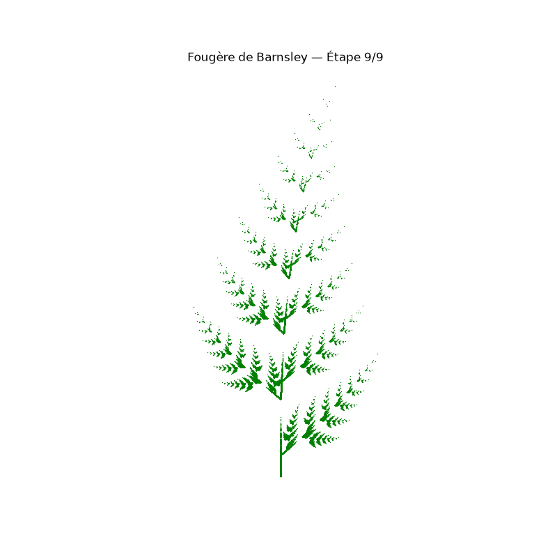
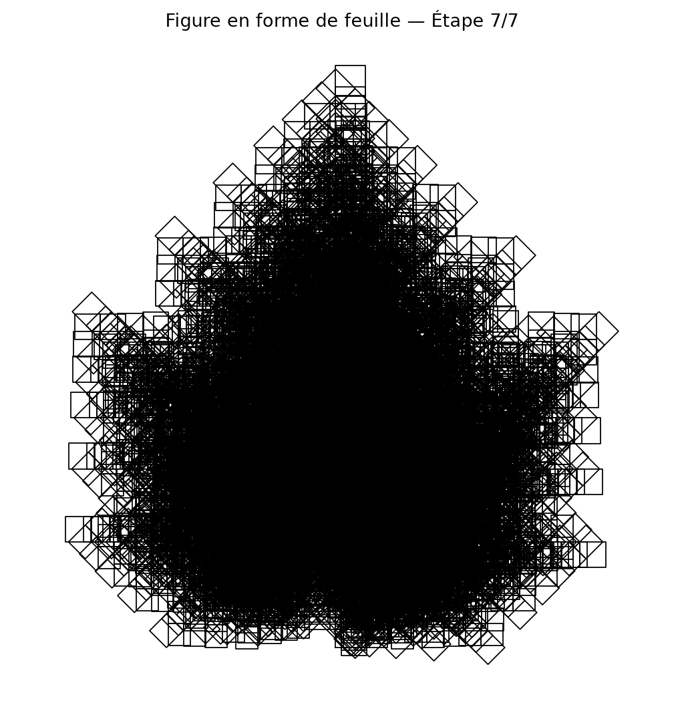

# Génération d'images fractales par IFS

Projet universitaire de mathématiques appliquées encadré par **Rodolphe Garbit**, Université d'Angers (2 ECTS).

## Présentation

Ce projet étudie la génération de figures fractales à l'aide de **systèmes de fonctions itérées** (*Iterated Function Systems*, IFS). Un IFS est un ensemble fini d'applications contractantes. L'itération de ces transformations permet d'approcher un attracteur. Sous les hypothèses appropriées, son existence et son unicité sont justifiées par le théorème du point fixe de Banach sur l'espace des compacts muni de la distance de Hausdorff.

Les transformations affines ont la forme `w(x) = A @ x + b` : NumPy effectue les calculs matriciels et Matplotlib représente les étapes de construction.

## Résultats : images finales

Les figures ci-dessous correspondent à la **dernière itération enregistrée** pour chaque exemple. Elles sont générées automatiquement en lançant les scripts. Les images intermédiaires sont présentées à l'écran pendant l'exécution, mais **seule l'image finale** est enregistrée dans `images/`.

### Triangle de Sierpiński


### Fougère de Barnsley



### Figure en forme de feuille



> **Origine du code :** les matrices de la fougère et de la feuille sont tirées de l'annexe du rapport. Les transformations du triangle de Sierpiński ont été reconstruites, car elles sont manquantes dans l'export Markdown du rapport.

## Structure du dépôt

```text
.
├── ifs.py                 # Fonctions mathématiques et visualisation progressive
├── examples/
│   ├── sierpinski.py      # Exemple Sierpiński
│   ├── fougere.py         # Fougère de Barnsley
│   └── feuille.py         # Figure en forme de feuille
├── images/
│   ├── sierpinski.png     # Dernière étape
│   ├── fougere.png        # Dernière étape
│   └── feuille.png        # Dernière étape
├── requirements.txt
├── .gitignore
└── README.md
```

## Installation (Ubuntu / VS Code)

Python 3.10 ou version supérieure conseillé.

```bash
python -m venv .venv
source .venv/bin/activate
pip install -r requirements.txt
```

**Pour voir les fenêtres Matplotlib**, exécuter les scripts dans un terminal VS Code sur un ordinateur avec interface graphique. Si l'interface ne s'ouvre pas, vérifier que Matplotlib dispose d'un backend graphique (par exemple TkAgg ou QtAgg), et installer les dépendances graphiques nécessaires.

## Afficher toutes les étapes de construction

Depuis la racine du dépôt :

```bash
python examples/sierpinski.py
python examples/fougere.py
python examples/feuille.py
```

À chaque exécution :

1. Une fenêtre Matplotlib s'ouvre pour présenter l'étape initiale (**étape 0**).
2. Le dessin est remplacé successivement par les étapes **1, 2, 3…**.
3. Le terminal indique l'étape courante et le nombre de figures générées.
4. **La dernière étape** est sauvegardée dans `images/` puis reste affichée jusqu'à la fermeture de la fenêtre.

L'intervalle entre deux étapes est de **0,8 seconde** par défaut. Vous pouvez l'augmenter avec `--pause` :

```bash
python examples/sierpinski.py 7 --pause 1.5
python examples/fougere.py 8 --pause 1
python examples/feuille.py 6 --pause 1
```

Le premier argument indique le **nombre d'itérations**. Les limites pratiques sont : Sierpiński 8, fougère 9 et feuille 7 itérations. Le nombre de copies croît exponentiellement avec le nombre d'itérations : des valeurs élevées augmentent la durée de calcul et l'utilisation de mémoire.

### Générer uniquement les images finales

Sur un serveur ou pour reconstruire les images du README sans fenêtre :

```bash
python examples/sierpinski.py 7 --no-show
python examples/fougere.py 8 --no-show
python examples/feuille.py 6 --no-show
```

Après la génération, **ajouter les fichiers PNG au dépôt Git** pour que les images s'affichent sur la page GitHub du README. GitHub ne les génère pas lorsqu'il affiche le Markdown : il lit les fichiers présents dans `images/`.

## Fonctions principales

- `rotation(point, angle)` : rotation autour de l'origine (degrés).
- `transformation(fig, ang, translation, fac_contr)` : rotation, contraction, translation.
- `etapes_fractale(fig_initial, transformations, nbre_iter)` : itérateur renvoyant les figures à chaque étape.
- `gen_fractal(fig_initial, transform, nbre_iter)` : résultat de la dernière étape uniquement.
- `dessiner_sur_axes(...)` : dessin sur un axe Matplotlib.
- `animer_fractale(...)` : animation étape par étape et sauvegarde de la dernière image.

## Fondements théoriques

Le rapport étudie la distance de Hausdorff, les contractions, le théorème du point fixe de Banach et les attracteurs de systèmes de fonctions itérées. Il présente également les figures de Koch et de Vicsek, sans que ces dernières soient implémentées dans le dépôt.

## Provenance et limites

Le rapport transmis présente une annexe Python dont l'indentation a disparu à l'export. Les scripts ont été reformatés, séparés en fichiers et adaptés à une visualisation progressive. Les définitions de Sierpiński ont été reconstruites : elles ne constituent pas une transcription littérale. Aucune version probabiliste de type *chaos game* n'a été récupérée dans l'annexe.

Les figures de ce dépôt sont générées par une méthode **déterministe et exhaustive**. Pour augmenter fortement le nombre d'itérations, une méthode probabiliste serait plus adaptée.

## Compétences mobilisées

Mathématiques appliquées, transformations affines, algorithmique, calcul matriciel, Python, NumPy et Matplotlib.
